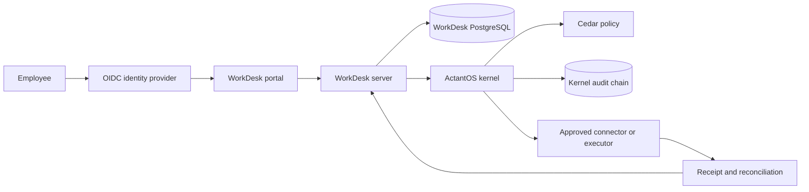
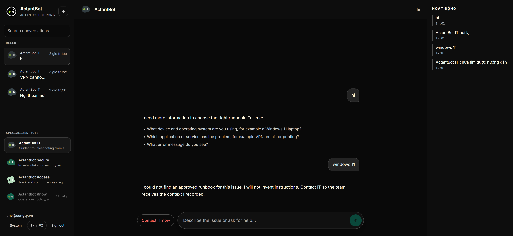
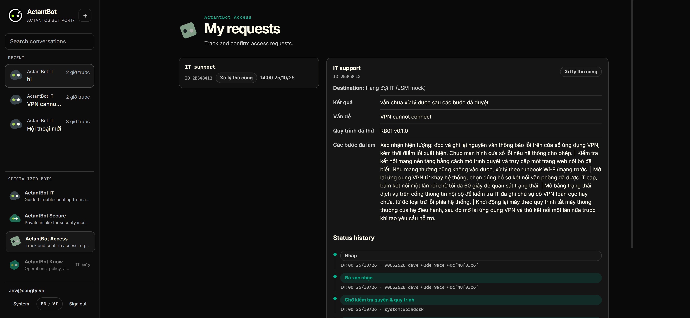
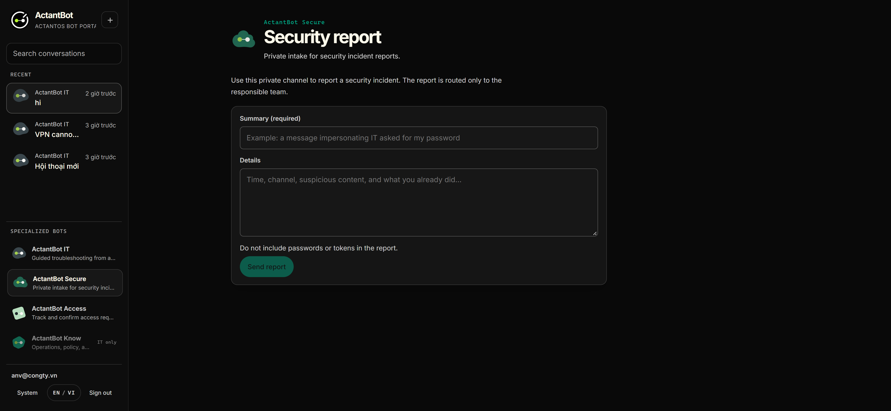

<p align="center">
  <a href="https://actantos.com/platform/workdesk">
    
  </a>
</p>

# ActantBot WorkDesk

<p align="center">
  Self-hosting guidance and deployment references for the ActantOS WorkDesk portal.
</p>

<p align="center">
  <a href="https://actantos.com">ActantOS</a> ·
  <a href="https://actantos.com/platform/workdesk">WorkDesk</a> ·
  <a href="https://eralab.si">ERA Lab</a> ·
  <a href="docs/hosting.md">Hosting</a> ·
  <a href="docs/operations.md">Operations</a>
</p>

<p align="center">
  <a href="https://github.com/kotobuki09/actantbot-workdesk/actions/workflows/docs.yml">
    
  </a>
</p>

WorkDesk is a self-hosted portal for the ActantBot family. It gives employees four focused surfaces for approved IT guidance, private security intake, access requests, and operations knowledge. The ActantOS kernel evaluates write actions against policy, signs the decision, and records an auditable receipt.

This repository is the public handoff for operators. It contains deployment guidance, configuration templates, architecture notes, operations procedures, and current product screenshots. It does not contain the WorkDesk application source, customer data, lab credentials, or production secrets.

## Start here

- [Hosting guide](docs/hosting.md) covers the deployment sequence.
- [Architecture](docs/architecture.md) explains the service boundary.
- [Operations guide](docs/operations.md) covers health checks, backups, upgrades, and degraded operation.
- [Troubleshooting](docs/troubleshooting.md) maps common symptoms to checks.
- [Vietnamese guide](README.vi.md) provides the same operator path in Vietnamese.
- [ActantOS WorkDesk](https://actantos.com/platform/workdesk) shows the product and the current portal interface.

## ActantOS ecosystem

- [ActantOS](https://actantos.com) is the product site.
- [WorkDesk](https://actantos.com/platform/workdesk) explains the employee IT support portal.
- [ERA Lab](https://eralab.si) provides the wider lab and project context.

## What you deploy

The reference deployment has five runtime concerns.

| Concern | Role | Default boundary |
| --- | --- | --- |
| WorkDesk server | Fastify BFF, OIDC session, chat orchestration, request state, and receipts | Private network |
| Portal | React and Vite user interface | Served by WorkDesk or behind the same ingress |
| ActantOS kernel | Cedar policy evaluation, decision signing, execution boundary, and audit chain | Private network |
| PostgreSQL | WorkDesk request data and kernel records | Private network, persistent volume |
| Keycloak or another OIDC provider | Workforce identity and session entry | Private network or approved identity boundary |

The reference Compose file uses operator-supplied images. Replace every image placeholder with an approved release before deployment. The public repository does not publish application images by itself.

## System flow



The server owns the user session and request state. The kernel owns the decision boundary. A request is not treated as complete until the connector result is reconciled and the receipt is recorded.

## Quick operator path

1. Read the [hosting guide](docs/hosting.md).
2. Copy `deploy/.env.example` to an operator-controlled environment file.
3. Replace image, identity, database, and secret placeholders.
4. Run `docker compose -f deploy/docker-compose.reference.yml --env-file deploy/.env config`.
5. Start the approved release with `docker compose -f deploy/docker-compose.reference.yml --env-file deploy/.env up -d`.
6. Verify the health endpoints and sign-in flow before opening the portal to employees.

Do not expose PostgreSQL or the kernel port to the public internet. Do not use the example credentials in a real environment. Do not enable the development login path in production.

## Current interface

The screenshots below come from the current ActantBot portal interface used by the ActantOS WorkDesk marketing surface.







## Capability boundary

The four bots have separate jobs.

- **ActantBot IT** follows approved troubleshooting runbooks.
- **ActantBot Secure** receives private security incident reports.
- **ActantBot Access** tracks and confirms access requests.
- **ActantBot Know** provides approved policy and operations guidance.

The portal must not collect passwords, one-time passcodes, or raw provider tokens. The kernel must deny actions outside the approved runbook and policy scope. The current product includes a mock ticket connector in its lab path. Treat a mock receipt as test evidence, not as proof of a live provider integration.

## Validation before handoff

Run these checks from the host that will run the deployment.

```bash
docker compose -f deploy/docker-compose.reference.yml --env-file deploy/.env config
docker compose -f deploy/docker-compose.reference.yml --env-file deploy/.env ps
curl -fsS "${WORKDESK_PUBLIC_URL}/healthz"
docker compose -f deploy/docker-compose.reference.yml --env-file deploy/.env exec kernel wget -qO- http://localhost:3100/healthz
```

Then sign in with a non-admin test account, submit a harmless request, confirm the approval boundary, and check the resulting receipt. Record the release identifier and the verification result in the operator change record.

The public surface check is available at `scripts/check-public-surface.ps1`. Run it before publishing changes.

## Contributing

Read [CONTRIBUTING.md](CONTRIBUTING.md) before changing the public guide. Keep examples safe to copy. Use placeholders for credentials, domains, tenant identifiers, and provider IDs.

## Security

Read [SECURITY.md](SECURITY.md). Never open a public issue with a secret, token, customer record, or private deployment detail.

## License

No open-source license is declared in this repository yet. Copyright and reuse permissions remain with the repository owner until a license is added.
