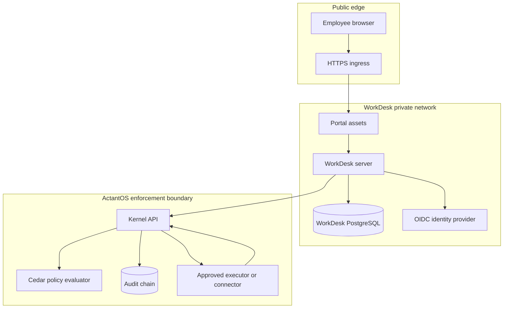

# ActantBot WorkDesk architecture

This page explains the runtime boundary for operators and reviewers.

## Service boundary

## Ownership

| Boundary | Owns | Must not own |
| --- | --- | --- |
| Portal | Rendering, locale, accessible input, and receipt views | Policy decisions or provider credentials |
| WorkDesk server | OIDC session, request state, runbook conversation, and reconciliation calls | Unapproved actions or raw secret collection |
| Kernel | Policy evaluation, decision token, execution boundary, and audit chain | Browser presentation or user session state |
| Connector | A narrow provider operation and its result | Policy approval or arbitrary commands |
| PostgreSQL | Durable records inside its tenant boundary | Secrets that should live in a secret manager |

## Request lifecycle

1. The employee signs in through the configured OIDC provider.
2. The server checks the user and tenant boundary before loading context.
3. The bot selects an approved runbook or routes the request to a human.
4. The user previews the exact request content.
5. The approver grants the required consent.
6. The kernel evaluates Cedar policy and signs the decision.
7. The executor checks the decision token and runs the narrow connector operation.
8. The server records the result, receipt, and status timeline.
9. An indeterminate result stays indeterminate until reconciliation proves the outcome.

## The four bots

| Bot | User need | Safe boundary |
| --- | --- | --- |
| ActantBot IT | Resolve a common employee IT issue | Approved runbooks only |
| ActantBot Secure | Report a suspected security issue | Private intake, no passwords or tokens |
| ActantBot Access | Request and track access | Explicit scope, approver, duration, and receipt |
| ActantBot Know | Find approved policy and operations guidance | Read-only guidance unless a separate runbook says otherwise |

## Deployment modes

The public Compose file is a production-shaped reference. It separates the WorkDesk database from the kernel database and keeps the kernel private. A local lab may use a different process layout, local Keycloak, or a no-op model adapter. Do not treat lab settings as production settings.

The product can operate without an external AI service when the no-op adapter is selected. If an operator enables a self-hosted model adapter, keep that service on the private network and apply the same data boundary as the WorkDesk server.
